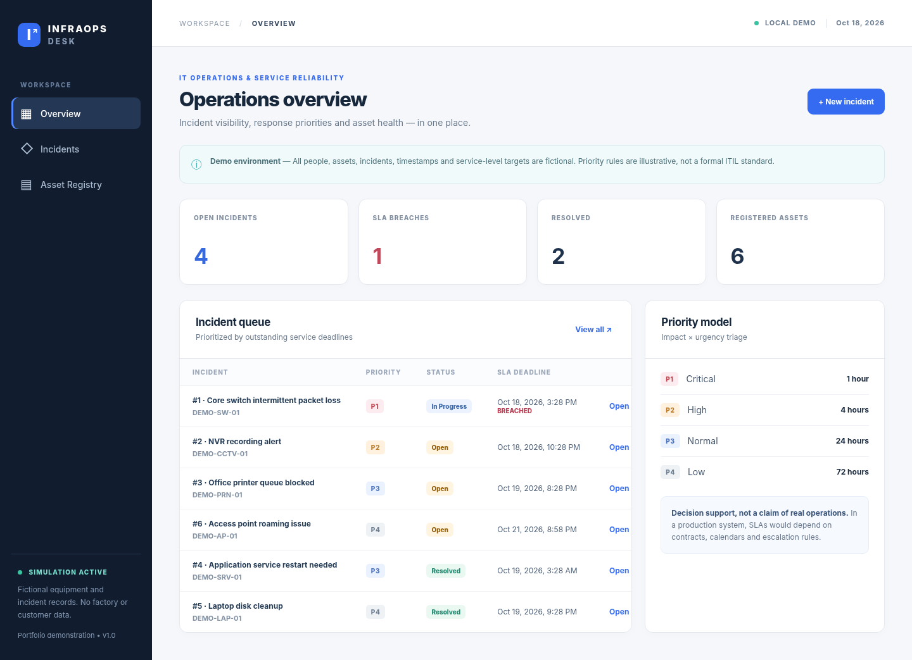

# InfraOps Desk

[](https://github.com/Tarekme1/InfraOps-Desk/actions/workflows/tests.yml)

MIHWAR is an IT service and asset operations workspace with a Python API and responsive employee and operator interfaces. It uses locally configured accounts and requires no external services or third-party Python packages.



*The included plant IT scenario is generated for product review. Assets, incidents, dates and service targets are illustrative and are not records of actual plant operations.*

## Run locally

Requires Python 3.10 or newer.

```bash
python app.py
```

Before starting, provision synthetic roles with environment variables. In PowerShell:

```powershell
$env:MIHWAR_EMPLOYEE_USER = "employee-demo"
$env:MIHWAR_EMPLOYEE_PASSWORD = "replace-with-a-local-demo-password"
$env:MIHWAR_TECH_USER = "tech-demo"
$env:MIHWAR_TECH_PASSWORD = "replace-with-a-local-demo-password"
$env:MIHWAR_ADMIN_USER = "admin-demo"
$env:MIHWAR_ADMIN_PASSWORD = "replace-with-a-local-demo-password"
py -3 app.py
```

Open **http://127.0.0.1:8765/** for the technician/admin workspace and **http://127.0.0.1:8765/employee** for the Arabic RTL employee portal. Account credentials are upserted at startup and only password hashes are stored. Do not commit passwords. On the first run, SQLite is initialized in `data/infraops.sqlite` with 12 sample assets and 27 generated scenario incidents dated March–October 2026. The interface identifies these records as illustrative. The schema migration retains existing incidents and supports employee tickets without a linked asset.

## Test

```bash
python -m unittest discover -s tests -v
```

The test suite exercises priority rules, input validation, HTTP endpoints, persistence, assignment and status history, employee ownership isolation, role checks, CSRF, legacy schema migration, data export, access to unlisted paths, response security headers, and aggregate counts. GitHub Actions runs this suite on Python 3.10, 3.12 and 3.13. See [verification notes](docs/VERIFICATION.md) for observed results and limitations.

## Features

- Incident intake linked to a small device and infrastructure inventory.
- Arabic RTL employee portal for creating, tracking, and requesting reopening of owned tickets.
- Synthetic employee, technician, and administrator accounts with role checks and session-based CSRF protection.
- Admin assignment to configured technicians; technician view includes their assigned work and the unassigned queue.
- Technician/admin work notes can be internal or explicitly employee-visible; employee APIs suppress internal events.
- Login attempts are throttled per username and source address after five failures in a 15-minute window.
- Verified SQLite backup and restore CLI, including an automatic pre-restore safety copy.
- Impact + urgency priority calculation (P1–P4) with illustrative resolution targets.
- Open, in-progress and resolved states with an append-only action timeline.
- Dashboard counts, deadline breach indicators, filters and CSV export.
- Responsive interface, SQLite persistence and a dependency-free standard-library API.

## Project structure

| Path | Responsibility |
| --- | --- |
| `app.py` | Local HTTP server, routes and response handling |
| `store.py` | SQLite schema, incident business rules, persistence |
| `static/` | HTML, CSS and browser-side JavaScript |
| `tests/` | Unit and HTTP integration tests |
| `docs/` | UI screenshot and design notes |

## API overview

| Method | Route | Purpose |
| --- | --- | --- |
| GET | `/api/health` | Local readiness check |
| POST | `/api/login` | Authenticate a configured synthetic user |
| GET | `/employee` | Arabic employee portal |
| GET/POST | `/api/employee/tickets` | List or create only the signed-in employee's tickets |
| POST | `/api/employee/tickets/{id}/reopen` | Reopen an owned resolved ticket |
| POST | `/api/tickets/{id}/notes` | Technician/admin adds an internal or employee-visible work note |
| PATCH | `/api/tickets/{id}/assign` | Admin assigns a configured technician |
| GET | `/api/assets` | Asset inventory |
| GET | `/api/dashboard` | Incident totals and recent cases |
| GET | `/api/tickets?status=&q=` | Filter incidents |
| GET | `/api/tickets/{id}` | Incident and history |
| POST | `/api/tickets` | Create incident |
| PATCH | `/api/tickets/{id}` | Change status, append action note |
| GET | `/api/export.csv` | Download incident list |

Create an incident with JSON including `title`, `asset_id`, `impact`, `urgency`, and optional `description`. Impact and urgency are integers from 1 to 3. A resolution transition requires a non-empty note. The employee portal also supports a self-service reopen request for resolved tickets.

## Scope and limitations

**This repository is prepared for review and local evaluation; it is not an approved production service or a record of an employer deployment.** The included plant scenario is generated for product review; its dates, assets, incidents, activity and service targets are illustrative, not actual operational history. The server intentionally binds to `127.0.0.1`. Local tests cover authentication, role checks, CSRF, login throttling, and a backup/restore round trip; these are engineering safeguards, not a production security certification. TLS termination, scheduled/off-site backup, notification delivery, business-hour SLA calendars, operational monitoring, and an independent security review remain before real data or any network exposure. Do not expose it directly to the internet or enter real employee, customer or factory information. The priority matrix is configurable decision support and does not claim conformance to the ITIL framework.

See [architecture and design choices](docs/ARCHITECTURE.md) and [security notes](SECURITY.md).

## Database backup and restore

Create a verified backup outside the repository (the app should remain online while the SQLite backup API snapshots it):

```powershell
py -3 scripts/backup_db.py backup data/infraops.sqlite D:\MIHWAR-backups\infraops-2026-10-23.sqlite
```

Restore only after stopping the app. The command validates SQLite integrity and foreign keys, creates a timestamped `.pre-restore-*.bak` copy of the current database, then atomically installs the verified backup:

```powershell
py -3 scripts/backup_db.py restore D:\MIHWAR-backups\infraops-2026-10-23.sqlite data/infraops.sqlite
```

These commands were round-trip tested locally. They do not provide scheduling, off-site retention, encryption-at-rest, access control, or a tested recovery-time objective; those must be provided by the deployment environment before real data.

## Deployment boundary

The built-in server intentionally listens only on loopback and is suitable for local development. For a protected staging environment behind a same-host TLS reverse proxy, set `MIHWAR_SECURE_COOKIES=1`. If that proxy supplies `X-Forwarded-For`, also set `MIHWAR_TRUSTED_PROXY_IP` to the proxy's exact peer address and configure it to replace that header with one validated client IP. The app trusts no forwarded address otherwise. Configure HTTPS redirects, HSTS, request limits, access logs and health monitoring at the proxy/host. Do not expose the Python server directly or treat this as production approval; run a deployment-specific security review and recovery drill first.

